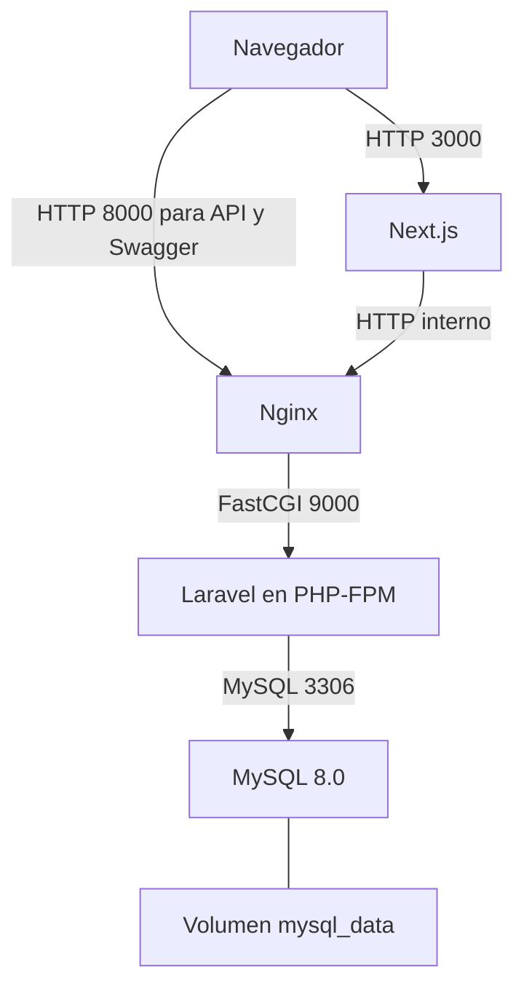

# E-commerce con Docker multi-stage

Entrega de la actividad **Ingeniería de Imágenes Eficientes**. Integra dos proyectos del bootcamp, el catálogo y flujo de compra en Next.js 16 con App Router y la API REST de e-commerce en Laravel 12 con JWT, órdenes, Stripe de prueba y Swagger. MySQL almacena usuarios, productos, órdenes y pagos.

## Arquitectura



Compose coordina tres componentes funcionales en cuatro contenedores. Nginx es el servidor HTTP del backend. El frontend resuelve la API mediante el nombre interno `nginx` desde el servidor Next.js. Las redes `web`, `application` y `database` limitan qué contenedores pueden comunicarse entre sí. MySQL y PHP-FPM usan puertos internos. Los puertos publicados se vinculan a `127.0.0.1` de forma predeterminada.

El arranque espera a que MySQL acepte una consulta con el usuario de la aplicación. Laravel aplica las migraciones y luego inicia PHP-FPM. Nginx comprueba el catálogo a través de Laravel y MySQL antes de que arranque Next.js.

## Arrancar el proyecto en Windows

Abre Docker Desktop con contenedores y abre PowerShell en la carpeta de `docker-compose.yml`. Ejecuta un comando por bloque. Si conservas el `.env` con el que funcionó tu tienda, cópialo a esta carpeta y pasa a **Levantar los servicios**.

### Escribir las cuatro claves en .env

**1. Crea el archivo si falta.** Cierra cualquier copia abierta en el Bloc de notas para evitar guardar una versión antigua sobre los cambios.

```powershell
if (-not (Test-Path -LiteralPath .\.env)) { Copy-Item .\.env.example .\.env }
```

**2. Comprueba si Docker ya tiene el volumen de la tienda.** Un nombre en la salida indica que el proyecto tiene una base existente. Si Docker da un error, abre Docker Desktop y repite el comando.

```powershell
docker volume ls -q --filter label=com.docker.compose.project=ecommerce-docker --filter label=com.docker.compose.volume=mysql_data
```

**3. Elige el origen de las claves.** Si apareció un volumen, ejecuta la línea siguiente para recuperar la configuración de tus contenedores anteriores, incluso si están detenidos. Si los eliminaste y solo conservas el volumen, recupera el `.env` anterior. Puedes comprobar sus nombres con `docker ps -a`.

```powershell
$origen = docker inspect --format '{{json .Config.Env}}' ecommerce-docker-backend-1 ecommerce-docker-mysql-1
```

Solo si el paso 2 terminó correctamente y no mostró un volumen, indica que la instalación es nueva.

```powershell
$origen = 'NUEVA'
```

**4. Descarga la imagen de Node para los cuatro comandos.**

```powershell
docker pull node:24-alpine
```

**5. Guarda cada clave por separado.** Ejecuta los cuatro comandos en la terminal donde definiste `$origen`. El montaje de tu carpeta permite escribir directamente en el `.env` de Windows. Cada comando indica la variable guardada o avisa que ya tenía valor. Los secretos no aparecen en la salida.

**Clave de cifrado de Laravel**

```powershell
$origen | docker run --rm -i -v "${PWD}:/proyecto" -w /proyecto node:24-alpine node herramientas/clave.mjs APP_KEY
```

**Clave de firma de los JWT**

```powershell
$origen | docker run --rm -i -v "${PWD}:/proyecto" -w /proyecto node:24-alpine node herramientas/clave.mjs JWT_SECRET
```

**Contraseña del usuario de la aplicación**

```powershell
$origen | docker run --rm -i -v "${PWD}:/proyecto" -w /proyecto node:24-alpine node herramientas/clave.mjs MYSQL_PASSWORD
```

**Contraseña del administrador de MySQL**

```powershell
$origen | docker run --rm -i -v "${PWD}:/proyecto" -w /proyecto node:24-alpine node herramientas/clave.mjs MYSQL_ROOT_PASSWORD
```

**6. Verifica que las cuatro variables están guardadas.** Deben aparecer sus cuatro nombres, sin mostrar los valores.

```powershell
(Select-String -LiteralPath .\.env -Pattern '^(APP_KEY|JWT_SECRET|MYSQL_PASSWORD|MYSQL_ROOT_PASSWORD)=\S+' -AllMatches).Matches | ForEach-Object { $_.Groups[1].Value }
```

La plantilla usa `MYSQL_DATABASE=ecommerce_api` y `MYSQL_USER=ecommerce`. Si tus credenciales anteriores contienen caracteres no ASCII en Windows PowerShell 5.1, configura UTF-8 antes de volver a ejecutar desde el paso 3.

```powershell
$OutputEncoding = [Console]::OutputEncoding = [System.Text.UTF8Encoding]::new($false)
```

### Levantar los servicios

**1. Valida el archivo de configuración.** Si el comando termina sin mensajes, Compose ha podido leer las variables obligatorias. Si indica que falta una clave, ejecuta el comando de esa variable desde la raíz.

```powershell
docker compose config --quiet
```

**2. Construye las imágenes y levanta toda la tienda.** Este es el comando de arranque de la actividad. Incluye Next.js, Laravel con Nginx y MySQL.

```powershell
docker compose up -d --build --wait
```

**3. Comprueba el estado.** Deben aparecer `mysql`, `backend`, `nginx` y `frontend` con estado `healthy`.

```powershell
docker compose ps
```

### Comprobar la base de datos, la API y la tienda

**1. Confirma que Laravel puede consultar las migraciones** en la base de datos `ecommerce_api`. Deben aparecer como `Ran`. El backend ya las aplica al arrancar.

```powershell
docker compose exec backend php artisan migrate:status
```

**2. Consulta los productos que hay en MySQL a través de la API.** Si `data` está vacío en una instalación nueva, pasa al siguiente paso. Si ya ves productos, abre la tienda.

```powershell
(Invoke-RestMethod 'http://localhost:8000/api/products').data
```

**3. Solo si el catálogo está vacío, carga los diez productos de ejemplo.** El sembrador agrega los SKU que faltan y conserva los productos que ya existen. Luego, vuelve a consultar la API o recarga la tienda.

```powershell
docker compose exec backend php artisan db:seed --class=ProductSeeder --force
```

| Qué abrir | Qué deberías ver |
| --- | --- |
| [Tienda · localhost:3000](http://localhost:3000) | Catálogo visual de Next.js, con precios y botones para agregar al carrito. |
| [API · localhost:8000/api/products](http://localhost:8000/api/products) | Respuesta JSON de Laravel con los mismos productos. |
| [Swagger · localhost:8000/api/documentation](http://localhost:8000/api/documentation) | Documentación interactiva de la API. |

Compose configura Laravel con `DB_HOST=mysql` y `DB_PORT=3306`. El nombre `mysql` identifica el servicio en la red privada de Docker. Laravel recibe el nombre de la base, el usuario y la contraseña del `.env` raíz. Los datos se guardan en `mysql_data` y el puerto 3306 queda dentro de Docker.

Para comprobar la autenticación en Swagger, registra un cliente con `POST /api/auth/register`, copia el `data.access_token` devuelto y pégalo en **Authorize**. Al ejecutar `GET /api/auth/me` debes recibir los datos del cliente.

### Traer las imágenes originales de phpMyAdmin o XAMPP

La tienda carga `products.image_url` en el catálogo y en el detalle. El MySQL de XAMPP y el de Docker tienen datos independientes aunque ambas bases se llamen `ecommerce_api`. Para traer tus fotos originales a Docker, exporta la tabla una vez.

**1. En phpMyAdmin**, selecciona `ecommerce_api → products → Exportar → Personalizado → CSV`. Exporta todas las filas en UTF-8, con comillas dobles para encerrar y escapar los campos, y marca **Poner los nombres de columna en la primera fila**. Guarda el archivo como `productos.csv` junto a `docker-compose.yml`. Así se exportan las URLs completas aunque la vista muestre `...`.

El CSV debe contener `sku`, `name`, `description`, `price`, `stock`, `image_url` e `is_active`. Se admiten coma y punto y coma como separador. Puedes incluir también el ID y las fechas que agrega phpMyAdmin.

**2. Con el proyecto levantado, copia el CSV al contenedor.**

```powershell
docker compose cp .\productos.csv backend:/tmp/productos.csv
```

**3. Importa las URLs en el MySQL de Docker.** Si el SKU existe se actualiza únicamente `image_url`. Si falta el SKU, se crea la ficha con los datos del CSV y un ID nuevo. Las filas sin URL se omiten. Un registro inválido revierte los cambios de esa importación.

```powershell
docker compose exec backend php artisan productos:importar-imagenes /tmp/productos.csv
```

**4. Verifica los enlaces completos desde la API.** Si exportaste los 11 productos activos, aquí puedes ver las 11 fichas. XAMPP puede quedar cerrado después de exportar el CSV.

```powershell
(Invoke-RestMethod 'http://localhost:8000/api/products?per_page=100').data | Select-Object sku,image_url | Format-List
```

**5. Abre el catálogo y entra al detalle de un producto.** Si la URL está vacía o el proveedor rechaza la carga, el frontend intenta mostrar la imagen local del SKU. El proyecto incluye diez imágenes WebP de muestra y una imagen genérica para los productos que carecen de foto propia. [Abrir la tienda](http://localhost:3000)

Si quieres distribuir en GitHub esas mismas fichas, puedes guardar el CSV de productos como `backend/database/seeders/catalogo.csv` antes de construir la imagen. En una instalación nueva, después del arranque se importa el catálogo incluido con este comando.

```powershell
docker compose exec backend php artisan productos:importar-imagenes database/seeders/catalogo.csv
```

### Si falla el arranque

- **Puerto 8000 ocupado.** Si tienes un `php artisan serve` escuchando ahí, puedes detenerlo con **Ctrl+C** en su terminal. Si quieres conservarlo, edita `API_PORT=8000` y `APP_URL=http://localhost:8000` en el `.env`, ejecuta otra vez el paso de arranque y abre la API y Swagger en el puerto 8000.
- **MySQL indica `MYSQL_USER="root"`.** Confirma que el `.env` tiene `MYSQL_USER=ecommerce`. Si PowerShell heredó `MYSQL_USER=root`, ejecuta `Remove-Item Env:MYSQL_USER -ErrorAction SilentlyContinue` en su propia línea y vuelve a levantar los servicios.
- **Acceso denegado después de copiar la plantilla sobre una instalación existente.** Recupera el `.env` que usabas con ese volumen. Editar la plantilla cambia los valores que recibe Compose, pero las contraseñas que ya existen en MySQL se conservan.
- **Un servicio sigue en `unhealthy`.** Ejecuta `docker compose logs --tail=80 mysql backend nginx frontend` para localizar el primer error.

## Probar el checkout

1. Registra un cliente en la tienda y añade un producto al carrito.
2. En el checkout, pulsa **Crear orden**. El modo predeterminado `CHECKOUT_MODE=order` guarda la orden y actualiza el inventario en MySQL. En **Mis órdenes** aparecerá como `pending` porque aún está pendiente de pago.
3. Para probar el cobro en Stripe, configura `CHECKOUT_MODE=stripe` y `STRIPE_SECRET` con una clave secreta del entorno de prueba. Aplica los cambios con `docker compose up -d --wait`. El botón **Crear orden y pagar** usa `pm_card_visa` y confirma el pago si Stripe devuelve `succeeded`. Si la llamada falla, puedes reintentar sobre la misma orden mientras sigas en el checkout.

`STRIPE_WEBHOOK_SECRET` se usa si configuras un webhook de prueba. Para las pruebas básicas de la actividad basta con registrar y consultar la orden.

`docker compose down` detiene el entorno y conserva los datos. Después de ejecutarlo, prueba `docker compose up -d --wait` y confirma que el catálogo sigue cargado. MySQL usa las variables de inicialización cuando el volumen está vacío. Para rotar las contraseñas de una base persistente, actualiza también las cuentas en MySQL.

## Decisiones de construcción

| Servicio | Capas y etapa final |
| --- | --- |
| Next.js | `node:24-alpine` cumple el mínimo de Node.js 20.9 que requiere Next.js 16. Se copian primero `package.json` y `package-lock.json` para reutilizar la capa de dependencias cuando cambia el código. `npm ci` instala dependencias bloqueadas y usa una caché de BuildKit. El build ejecuta `next build`. La imagen final contiene las dependencias de producción, la salida `.next`, las imágenes de `public/` y la configuración que necesita `next start`. El proceso corre como `node`. La consulta del catálogo se ejecuta al recibir la solicitud, de modo que el build puede correr antes de que exista la API. |
| Laravel | `php:8.2-fpm-alpine` ejecuta Laravel con PDO MySQL y OPcache. El build comprueba `pdo_mysql`, `mbstring`, `openssl`, `tokenizer`, `xml`, `ctype` y `json`. Composer instala las dependencias de `composer.lock` con `--no-dev` y optimiza el autoloader. La etapa final copia únicamente `vendor/` desde `build` y toma el código y el manifiesto `composer.json` del proyecto. Artisan usa el manifiesto para descubrir los comandos. Artisan genera `storage/api-docs/api-docs.json` en esa imagen durante la construcción. PHP-FPM corre como `www-data`. |
| Nginx | La imagen ligera de Alpine incluye la configuración FastCGI. Nginx envía las solicitudes al punto de entrada `public/index.php` de Laravel y corre como `nginx` en el puerto 8000. |
| MySQL | El Dockerfile hereda la imagen oficial `mysql:8.0` directamente. El entrypoint oficial prepara la base y el usuario, y guarda los datos en `/var/lib/mysql`. Laravel crea el esquema con migraciones. |

Los archivos `.dockerignore` excluyen secretos locales, dependencias instaladas en el host y material ajeno al build. Los lockfiles fijan dependencias de la aplicación. Las imágenes base se referencian por etiquetas de versión y pueden recibir revisiones del proveedor.

El Compose usa una configuración de ejecución de producción para validar la contenerización con acceso local. Para exponer la tienda públicamente, configura HTTPS y revisa la autorización del catálogo y el flujo de pagos del proyecto original. Stripe queda disponible como opción para la prueba de checkout.

## Medir imágenes y observar la caché

1. Compila el frontend y el backend sin reutilizar sus capas.

   ```sh
   docker compose --progress plain build --no-cache frontend backend
   ```

2. Repite la compilación con la caché habilitada.

   ```sh
   docker compose --progress plain build frontend backend
   ```

3. Consulta los tamaños de las imágenes de la entrega.

   ```sh
   docker image ls "ecommerce-*:local"
   ```

4. Inspecciona las capas del frontend.

   ```sh
   docker image history ecommerce-frontend:local
   ```

5. Inspecciona las capas de Laravel.

   ```sh
   docker image history ecommerce-laravel:local
   ```

Registra los tiempos de ambas compilaciones y compara las líneas `CACHED`. La primera reconstruye las capas y puede reutilizar el contenido de las cachés de descarga. La segunda muestra qué capas se reutilizan al repetir el build. Para un build frío, ejecuta la primera medición con un builder nuevo. Si tienes las imágenes originales, compara sus tamaños con las finales usando la misma plataforma y `docker image ls`.

El workflow **Validar Docker Compose** construye y levanta el entorno en GitHub Actions. Comprueba la API, Swagger, el catálogo renderizado, la creación de una orden sin Stripe, la respuesta controlada cuando falta la clave y la persistencia de la orden tras recrear los contenedores. También prueba la importación de URLs, la conservación del stock y la presencia de la foto en el catálogo y en el detalle. La pestaña **Actions** muestra el resultado y los tamaños que reporta Compose.

## Lista de entrega

| Requisito | Implementación |
| --- | --- |
| Next.js 16+ con App Router y puerto 3000 | `frontend/src/app` y Dockerfile multi-stage con `next build` y `next start`. |
| Laravel con PHP 8.2+ y proxy | `backend/Dockerfile` prepara PHP-FPM y dependencias. Nginx publica el puerto 8000. |
| MySQL 8.0 | Imagen oficial, cuatro variables de inicialización y volumen persistente. El puerto 3306 queda en la red interna. |
| Compose, variables documentadas y código fuente | `docker-compose.yml`, `.env.example`, `frontend/` y `backend/`. |
| README | Diagrama, instrucciones, decisiones por imagen y comandos de medición. |
| Repositorio público | Publicar el repositorio con visibilidad pública y comprobar el resultado en Actions. |

## Referencias

- [Next.js 16 y requisitos de ejecución](https://nextjs.org/docs/app/guides/upgrading/version-16)
- [Orden de arranque y healthchecks en Docker Compose](https://docs.docker.com/compose/how-tos/startup-order/)
