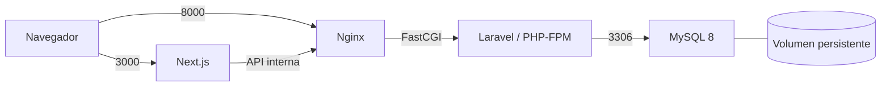

# E-commerce con Docker

Tienda en Next.js 16 y API en Laravel 12, con MySQL 8, autenticación JWT y pagos de prueba con Stripe. Docker Compose inicia la tienda, la API y la base de datos.

## Arquitectura



Docker Compose ejecuta cuatro contenedores: Next.js sirve la tienda, Nginx recibe las solicitudes de la API y las dirige a Laravel, y MySQL almacena usuarios, productos, órdenes y pagos. La base de datos solo es accesible dentro de la red de Docker; sus datos permanecen en un volumen. Stripe se integra de forma opcional para probar pagos.

## Requisitos

- Windows con Docker Desktop instalado y en ejecución.
- PowerShell abierto en la carpeta donde está `docker-compose.yml`.

## Configurar y arrancar

1. Crea `.env` desde la plantilla si todavía no existe:

   ```powershell
   if (-not (Test-Path -LiteralPath .\.env)) { Copy-Item .\.env.example .\.env }
   ```

2. Para una instalación nueva, genera las cuatro claves necesarias:

   ```powershell
   $origen = 'NUEVA'
   foreach ($clave in @('APP_KEY', 'JWT_SECRET', 'MYSQL_PASSWORD', 'MYSQL_ROOT_PASSWORD')) {
       $origen | docker run --rm -i -v "${PWD}:/proyecto" -w /proyecto node:24-alpine node herramientas/clave.mjs $clave
   }
   ```

   Si ya tienes datos en el volumen `mysql_data`, conserva el `.env` que usabas. No generes contraseñas nuevas para esa base de datos.

3. Valida la configuración y levanta los servicios:

   ```powershell
   docker compose config --quiet
   docker compose up -d --build --wait
   docker compose ps
   ```

Laravel aplica las migraciones al arrancar. Si la base de datos está vacía, carga los productos de ejemplo:

```powershell
docker compose exec backend php artisan db:seed --class=ProductSeeder --force
```

## Direcciones

- Tienda: <http://localhost:3000>
- API: <http://localhost:8000/api/products>
- Swagger: <http://localhost:8000/api/documentation>

## Comandos útiles

```powershell
# Ver estado y salud de los servicios
docker compose ps

# Ver registros de los servicios
docker compose logs --tail=80 frontend nginx backend mysql

# Revisar las migraciones
docker compose exec backend php artisan migrate:status

# Detener los servicios; conserva los datos de MySQL
docker compose down
```

El checkout crea órdenes sin configurar Stripe. Para probar pagos, configura `CHECKOUT_MODE=stripe` y una clave secreta de prueba en `STRIPE_SECRET` dentro de `.env`, y aplica el cambio:

```powershell
docker compose up -d --wait
```

No publiques el archivo `.env`: contiene claves y contraseñas.
